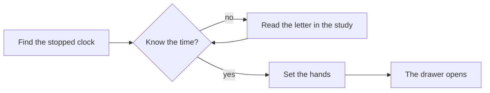

This entry is a reference. Each section below shows one kind of block, written directly in Markdown. All pictures here are placeholders.

## Text

Ordinary Markdown works: **bold**, *italic*, ~~struck~~, `inline code`, and [links](https://example.com).

> Quotations are set like this, for lines of dialogue or notes from a playtest.

| Room | Puzzle | State |
| --- | --- | --- |
| Front hall | The stopped clock | Playable |
| Study | Letters in the desk | Blockout |

- [x] Task lists
- [ ] for work still to do

## Pictures and galleries

A single image is plain Markdown. A gallery wraps several:

<hx-gallery caption="Three rooms, as they stand this week">


</hx-gallery>

## Before and after

<hx-compare before="/media/sample/blockout.svg" after="/media/sample/lit.svg" before-label="Blockout" after-label="Lit" caption="Drag to compare"></hx-compare>

## Video

Short clips are uploaded with the entry; long ones are embedded from YouTube.

```html
<hx-video src="/media/my-entry/clip.mp4" caption="Opening the music box"></hx-video>
<hx-video youtube="VIDEO_ID" caption="Full playthrough of the hall"></hx-video>
```

## 3D models

```html
<hx-model src="/media/my-entry/brass-key.glb" alt="The brass key" caption="Turn it over"></hx-model>
```

## Diagrams



## Mathematics

Inline, such as $t = \frac{d}{v}$, or on its own line:

$$
\theta = \arctan\left(\frac{y_{\text{target}} - y}{x_{\text{target}} - x}\right)
$$

## Code

```cpp
void AMusicBox::OnInteract(APawn* Instigator)
{
    if (bWound && !bOpen)
    {
        bOpen = true;
        PlayLidTimeline();
    }
}
```

## Unreal

Blueprint graphs are embedded from blueprintUE:

```html
<hx-blueprint src="https://blueprintue.com/render/YOUR_ID/" caption="Door interaction graph"></hx-blueprint>
```

Build notes get their own card:

<hx-build version="0.1.0" changelist="1024" date="2026-11-11">

- Added the front hall blockout.
- Fixed the clock hands snapping on load.

</hx-build>

## Notes

<hx-note>

A plain note, for warnings and things we are unsure about.

</hx-note>
