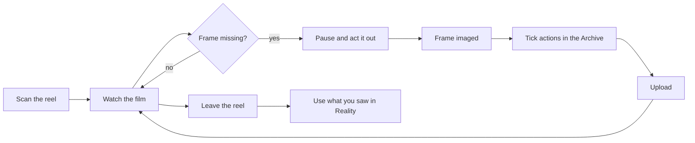

Our [first devlog](https://kingslayerrq.github.io/heritage-devlog/posts/2026-11-18-heritage-uncover-the-past-piece-together-your-own-story-41bd3745ac6c/) said Heritage lets you step inside damaged film reels and piece the story back together. This entry is about the first prototype that actually does it: one room, one reel, eight frames, two of them missing.

It is built from cubes and cylinders on purpose. Nothing here is art. The only thing we are testing is whether the loop is fun to think through.

<hx-note kind="clue">

**The pitch, in about thirty seconds.** You are a historian hired to catalogue an abandoned manor. The client has sent you a damaged film reel of one evening in this room. Scan the reel with your camera and step inside it: you watch the past play out frame by frame, but some frames are missing. When you hit a gap, pause the film. The room becomes yours to touch. Work out what must have happened, act it out yourself, and upload your version to restore the frame. Restore enough and the reel shows you something worth knowing back in the present.

</hx-note>

## The loop in one picture



## Two rooms, one evening

The prototype builds the same study twice. **Reality** is the room as you find it today. **Film** is the same room on the evening the reel was shot, graded warm, grainy and desaturated so you always know which one you are standing in.

Drag the slider. Everything that differs between the two is a clue: the fire is lit, the vase is still whole, and somebody was here.

<hx-compare before="/media/2026-11-18-missing-frame-prototype/compare-reality.webp" after="/media/2026-11-18-missing-frame-prototype/compare-film.webp" before-label="Reality" after-label="Film" caption="Same spot, two evenings"></hx-compare>

## Watching the reel

You start in Reality with a camera. <kbd>Tab</kbd> raises it, and holding the frame on something of value captures it. Capture the canister on the table and Reel 1 is yours; <kbd>Enter</kbd> steps inside.

<hx-video src="/media/2026-11-18-missing-frame-prototype/watch-the-reel.mp4" poster="/media/2026-11-18-missing-frame-prototype/film-butler-kettle.webp" caption="Scan the canister, enter the reel, and watch until the film runs out of frames it can show. Captured at a low frame rate from the current build."></hx-video>

The reel plays itself, one frame every second and a half. A butler arrives, takes the kettle from the table, and then the picture drops out. The filmstrip along the bottom is the whole interface for where you are: grey frames are readable, red is missing, dark is locked.

<hx-gallery caption="Frame 2 is readable. Frame 3 is not. Frame 4 shows a full kettle at the fireplace, and then the reel refuses to go further.">


</hx-gallery>

That last plate matters. Later frames stay locked until the gap before them is restored, so the reel cannot simply be watched to the end.

| Frame | What the reel shows | State |
| --- | --- | --- |
| 1 | A fire. A key in the hearth. The butler arrives. | Readable |
| 2 | The butler takes the kettle. | Readable |
| 3 | *Frame missing* | **Missing**, one action |
| 4 | The full kettle is brought to the fire. | Readable |
| 5 | *Frame missing* | **Missing**, two actions |
| 6 | The butler leaves the fireplace carrying the key. | Readable |
| 7 | The butler crosses the room. | Locked until 5 is restored |
| 8 | The butler stands before the closed portrait. | Locked until 5 is restored |

## Acting it out

<kbd>Space</kbd> pauses the film, and pausing is the whole trick. The HUD switches to `PAUSE / REC`, the props unfreeze, and a line appears: *You act in the butler's stead.* The kettle he was holding drops to the floor. It is yours now.

The frames on either side are the evidence. Empty kettle in frame 2, full kettle in frame 4. There is a basin in the corner.

<hx-video src="/media/2026-11-18-missing-frame-prototype/act-it-out.mp4" poster="/media/2026-11-18-missing-frame-prototype/pause-rec.webp" caption="Pause on frame 2, pick up the kettle, carry it to the basin and fill it. The filmstrip cell for frame 3 turns amber: imaged."></hx-video>

Doing the right thing does not restore the frame by itself. It *images* it: the game has recorded what you did and filed it against frame 3. The <kbd>N</kbd> key opens the Archive, where every action you recorded for that frame is listed as a checklist. You tick the ones that belong in the frame and upload.

<hx-gallery caption="Imaged, ticked, confirmed. Uploads are permanent.">


</hx-gallery>

Then the reel plays again, and this time frame 3 is there. You made it.

<hx-video src="/media/2026-11-18-missing-frame-prototype/restored-playback.mp4" poster="/media/2026-11-18-missing-frame-prototype/frame3-restored.webp" caption="After the upload: frame 3 plays as restored footage, frame 4 follows, and the reel runs into its second gap."></hx-video>

### The second gap asks for two things

Frame 5 needs two actions, and the room pushes back if you try them in the wrong order. Reach for the key in the hearth while the fire is lit and you get *Too hot to touch.* The full kettle from frame 4 is sitting right there.

<hx-gallery caption="Douse the fire, then the key can be taken. Two actions, one frame.">


</hx-gallery>

Under the hood a missing frame is nothing more than a set of facts the player has to produce, plus the snapshot to show once they do:

```cpp
// Frame 3: one action.
Reel.Scenes[2].Kind = EHeritageSceneKind::Missing;
Reel.Scenes[2].Answer.AddTag(HeritageTags::Fact_KettleFilled);
Reel.Scenes[2].Restored = { Butler(FVector(200, 190, 75)), Kettle(FVector(235, 190, 100), true) };

// Frame 5: two actions, in any order the room allows.
Reel.Scenes[4].Kind = EHeritageSceneKind::Missing;
Reel.Scenes[4].Answer.AddTag(HeritageTags::Fact_FireDoused);
Reel.Scenes[4].Answer.AddTag(HeritageTags::Fact_KeyTaken);
```

The gap on screen lasts two seconds per required action, so a longer silence in the film is itself a hint about how much is missing.

### You are allowed to be wrong

A paused film is a sandbox. Nothing stops you throwing the key at the vase.

<hx-gallery caption="Breaking the vase is not the answer to frame 5, but it is recorded all the same, and it turns up in the checklist as a decoy.">


</hx-gallery>

The upload only succeeds with exactly the right set, so the checklist is where reasoning gets checked: you did four things, but which of them did the butler do? <kbd>Backspace</kbd> rolls the scene back to how the frame began if the room has got out of hand.

The vase is also the prototype's one piece of knowledge that survives a rollback. Notice the toast: *You know where to look now.*

## Back in the present

Leave the reel and the study is cold again. But the vase you broke on that evening is, of course, already broken here. It always was. The shards on the pedestal now have something sitting among them.


The reel's last frame leaves the butler standing in front of the portrait with the key in his hand. Nothing in the present points at the portrait. No marker, no objective. The player either connects the two or does not.

<hx-gallery caption="Scan, use, and the portrait slides aside. The key opens the study door and ends the slice.">


</hx-gallery>

## What we want playtests to tell us

Nobody outside the team has played this yet. The next step is ten-minute sessions with players thinking out loud. We are testing three hypotheses, and for each one we have written down what we hope to *see* before we ask anything.

### Hypothesis 1: players can infer a missing frame from the frames around it

The frames before and after a gap give enough evidence to work out what happened, without being told.

**What we hope to see**

- [ ] On reaching the frame 3 gap, the player rewinds or re-watches frames 2 and 4 before acting.
- [ ] The player says the inference aloud before doing it: "the kettle was empty, now it's full, so he filled it."
- [ ] The player goes to the right object first (the basin for frame 3, the fireplace for frame 5) with little or no wandering.

<details>
<summary>Questions we will ask afterwards</summary>

1. What do you think happened in the missing frame, and what told you that?
2. Was there a moment you were guessing rather than reasoning? What was missing?
3. Did the frame after the gap help, or did it just give the answer away?

</details>

### Hypothesis 2: acting it out yourself is more satisfying than choosing an answer

Pausing and physically performing the action feels like reconstructing history, not filling in a form.

**What we hope to see**

- [ ] The player pauses unprompted at or just before a gap and starts handling objects.
- [ ] The player experiments beyond the solution (throws something, breaks the vase, shoves the butler) and then uses rollback rather than getting stuck.
- [ ] In the Archive, the player ticks the right actions quickly and reacts visibly when playback resumes from the restored frame.

<details>
<summary>Questions we will ask afterwards</summary>

1. When you paused the film, what did you think you were allowed to do?
2. How did it feel to perform the action versus ticking it in the checklist afterwards? Which felt like the "real" answer?
3. Did you ever worry you had broken the scene? What did you do about it?

</details>

### Hypothesis 3: players connect what they saw in the film to what they can do in Reality

Knowledge from the reel changes how players read the present-day room, with no objective marker needed.

**What we hope to see**

- [ ] After leaving the reel, the player walks to the portrait without being told.
- [ ] The player compares the two rooms aloud (cold fireplace, broken vase, missing butler).
- [ ] The player who broke the vase in the film checks the shards in Reality for the second reel.

<details>
<summary>Questions we will ask afterwards</summary>

1. When you came back to the present, where did you go first and why?
2. What do you think the relationship is between the film and the real room? Can you change the past?
3. Was there anything you saw in the film that you wanted to check in the present but couldn't?

</details>

## Things we already know to watch for

<hx-note>

**The portrait opens without restoring anything.** A player who pokes it early can finish the slice without touching the reel, which would make Hypothesis 3 untestable for that session. We will either note when it happens or steer the first objective toward the reel.

</hx-note>

<hx-note>

**Scan-before-use is unexplained friction.** The portrait and the key must be scanned with the camera before <kbd>F</kbd> does anything. If players stall there, that is a tutorial problem, not evidence against the hypotheses, and we will record it separately.

</hx-note>

<hx-note>

**The Archive wants a mouse.** Capturing this entry turned up a keyboard dead end: on frame 5, arrow-key focus jumps from the filmstrip straight to the audio buttons and never reaches the checklist. Playtests will use the mouse until that is fixed.

</hx-note>

## Next

- Run the first ten-minute sessions and write up what the three hypotheses look like against real players.
- Fix keyboard focus in the Archive.
- Decide whether the portrait should stay openable before the reel is restored.

This is one of several small prototypes, each aimed at a different part of the game. More from the rest of the team soon.
