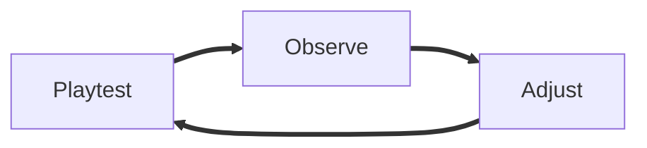

---
# Copy to src/content/posts/YYYY-MM-DD-short-topic.md before editing.
# 中文：先复制模板到文章目录；正文、标题、摘要、标签和图片说明使用英文。

# REQUIRED metadata / 必填信息：下面四项必须填写。
title: "First playtest: making the door feedback clearer"
date: 2026-11-11 # REQUIRED: replace this example date. / 必填：替换示例日期。
discipline: design # REQUIRED: tech / art / design / audio / narrative / production
authors: [your-author-id] # REQUIRED: use /devlog-access status. / 必填：填写已登记作者 ID，不是用户名。

# RECOMMENDED metadata / 建议填写：摘要和标签使用英文。
summary: "What we learned from the first door interaction test and how we improved its feedback."
tags: [Playtesting, Interaction] # Use [] if no tags apply. / 没有标签时可用 []。

# PUBLICATION / 发布：草稿也在公开仓库中可见，不要写入秘密。
draft: true # Set false for the local article preview and publication. / 本地预览文章页面和发布时改为 false。

# OPTIONAL cover: add a real image before uncommenting; use English alt text.
# 中文：封面可选。先添加真实图片，再取消下面两行注释并修改路径和英文说明。
# cover: /media/2026-11-11-first-playtest/cover.png
# coverAlt: "A green indicator above the unlocked door in the front hall."
---

<!--
BEFORE PUBLISHING
Required: title, valid date, one discipline, registered author IDs, and a nonempty English body.
Replace all example content with your own work. Summary, tags, and media are recommended or optional, not required fields.
Keep the article filename unchanged after publication. Set draft to false when ready.
The site already displays title as the main heading; start body sections with ##.
中文：必填项为标题、有效日期、一个专业分类、已登记作者 ID、非空英文正文。
请替换所有示例内容。下面的章节是建议结构，可以增删；中文说明只放在注释中。
注释不会显示在文章页面，但任何人都能在公开仓库中阅读，请勿放入私密信息。
-->

We tested whether players could tell when the front-hall door was ready to open. This entry explains the change, the evidence behind it, and what we still need to check.

## What changed

- Added a green indicator above the door when it unlocks.
- Kept the interaction prompt visible until the player opens the door.

## Why we changed it

During the first test, players missed the short unlock sound. We wanted the visual feedback to remain readable after the sound ended.

## Results and evidence

Describe what you tested, what you observed, and any limitations. Replace this paragraph with actual results; distinguish untested expectations from findings.

## Next steps

- Check whether the indicator remains visible in the darker lighting pass.
- Ask playtesters whether the prompt appears at the right distance.

<!--
OPTIONAL REFERENCE: TEXT STYLES AND STRUCTURE
Copy only the examples you need into your body, outside this comment. Replace their text.
Fonts and colors come from the site theme; arbitrary font families, inline styles, and custom CSS are not supported.
中文：以下为可选写法。只复制需要的示例到注释外，并替换内容。字体与颜色由网站统一控制。

## Section heading
### Subsection heading
#### Detail heading

Regular body text, **bold**, *italic*, ***bold italic***, ~~superseded text~~, and <u>underlined text</u>.
Use `DoorState.Open` for inline code. Subscript: H<sub>2</sub>O. Superscript: x<sup>2</sup>.

[An external reference](https://example.com)

> "I heard the sound, but I did not know which door had opened."

- A bullet point
- Another point

1. Reproduce the problem.
2. Change one variable.
3. Run the test again.

- [x] Add the indicator.
- [ ] Check the darker lighting pass.

| Version | Feedback | Observation |
| --- | --- | --- |
| Before | Sound only | Players missed the signal |
| After | Sound and light | Ready for the next test |

---

```cpp
void ADoor::Unlock()
{
    bLocked = false;
    ShowIndicator();
}
```



Inline math: $t = d / v$.

$$
t = \frac{d}{v}
$$
-->

<!--
OPTIONAL REFERENCE: IMAGES AND MEDIA
Add real files to public/media/<article-folder>/ before using these examples.
Article URLs start with /media/, not public/ or /heritage-devlog/. Match filename case exactly.
Use English descriptions and captions. Delete unused examples; there is no need to add every media type.
中文：先把真实媒体文件放进对应目录，再把需要的示例复制到注释外；图片描述和字幕使用英文。

Single image:


Animated GIF:


Gallery (keep blank lines inside the wrapper):
<hx-gallery caption="Two views of the updated front hall">


</hx-gallery>

Before/after comparison:
<hx-compare before="/media/2026-11-11-first-playtest/before.png" after="/media/2026-11-11-first-playtest/after.png" before-label="Before" after-label="After" caption="Compare the door feedback"></hx-compare>

Local video (MP4 or WebM; poster is optional):
<hx-video src="/media/2026-11-11-first-playtest/door-test.mp4" poster="/media/2026-11-11-first-playtest/cover.png" caption="The updated door interaction"></hx-video>

YouTube (replace VIDEO_ID with the video's ID, not its full URL):
<hx-video youtube="VIDEO_ID" caption="Full playtest walkthrough"></hx-video>

3D model (GLB with embedded textures and buffers):
<hx-model src="/media/2026-11-11-first-playtest/brass-key.glb" alt="A brass key with a round handle" caption="Rotate the key to inspect it"></hx-model>

File links (PDF, ZIP, or TXT):
[Read the playtest notes (PDF)](/media/2026-11-11-first-playtest/playtest-notes.pdf)
[Download the reference files (ZIP)](/media/2026-11-11-first-playtest/reference-files.zip)
[Read the change list (TXT)](/media/2026-11-11-first-playtest/changes.txt)

Unreal Blueprint (replace YOUR_ID with the BlueprintUE render ID):
<hx-blueprint src="https://blueprintue.com/render/YOUR_ID/" caption="Door interaction graph"></hx-blueprint>

Note (keep blank lines inside the wrapper):
<hx-note>

These results cover one room; the rest of the mansion still needs testing.

</hx-note>

Build notes (keep blank lines inside the wrapper):
<hx-build version="0.3.1" changelist="1482" date="2026-11-11">

- Added the door indicator.
- Fixed the interaction prompt timing.

</hx-build>
-->
